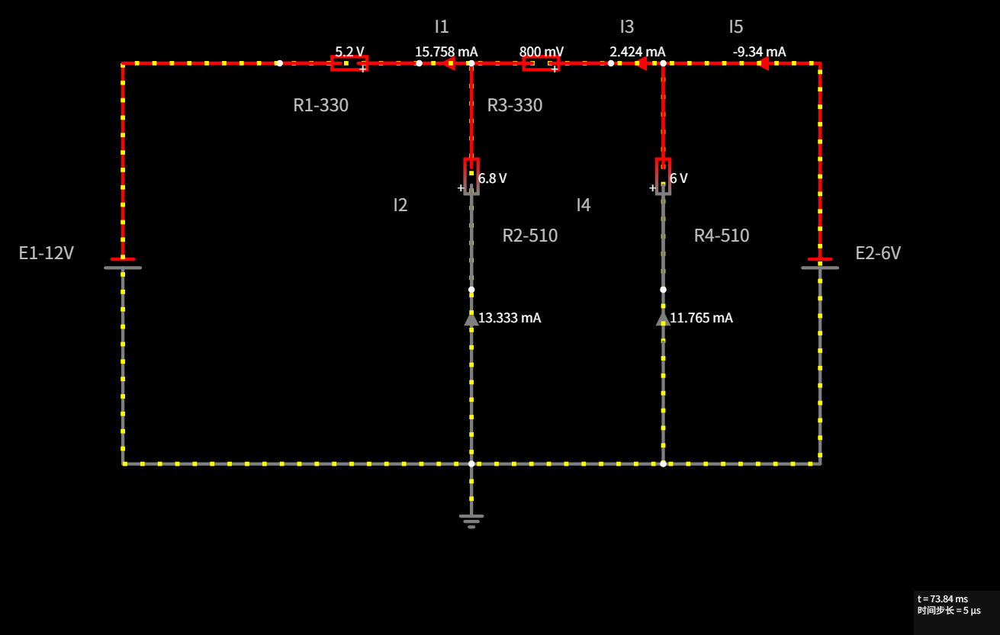

# 叠加定理虚拟实验 · CircuitJS

> 电工学 / 电路原理「叠加定理」虚拟实验：三个工况的电路代码、带仪表读数的截图、按模板写好的实验报告，
> 以及把电路代码一键变成可点击链接的小工具。



## 这个项目做了什么

课程实验要求用实验方法验证线性电路的叠加定理：R1 = R3 = 330 Ω，R2 = R4 = 510 Ω，
E1 = 12 V，E2 = 6 V，分别测量「E1 单独激励」「E2 单独激励」「两电源共同激励」三种情况下
5 条支路的电流（I1~I5）和 4 个电阻上的电压（UR1~UR4），再检验 ① + ② = ③。

由于实验是在浏览器里的 [CircuitJS](https://www.eetree.cn/circuitjs/circuitjs.html)（eetree 部署版）
上完成，本项目把「电路」本身做成了可复现的产物：

- **电路代码**：三个工况各一份 CircuitJS 电路文本（每行一个元件），粘贴即可重建整个电路；
- **一键链接**：把电路文本 URL 编码后拼到 `?cct=` 后面，打开链接电路就自动出现（见下文「接口」）；
- **读数**：电路里预先放了 5 只电流表（元件码 `370`）和 4 只电压表探头（元件码 `p`），
  画布上直接显示数字——这是该网站在没有读数 API 的情况下唯一能"读出数据"的办法；
- **报告**：按课程任务书模板填写，包含预习计算（节点电压法）、记录表、叠加校验、思考题与截图附录。

## 网站接口（逆向得到，均已实测）

eetree 的电路页就是标准的 CircuitJS1（GWT 编译版），查询参数会被转发给内嵌的 `circuitjs-real.html`：

| 参数 | 作用 |
|---|---|
| `cct` | **载入电路文本**（URL 编码），最有用 |
| `ctz` | 载入 LZString 压缩后的电路（站内"创建短链接"用的就是它） |
| `startCircuit` / `startLabel` | 载入站点内置示例电路 |
| `running` / `hideMenu` / `hideSidebar` / `editable` | 是否运行、隐藏菜单、隐藏侧栏、禁止编辑 |
| `whiteBackground` / `conventionalCurrent` | 白底、传统电流方向 |

**没有**读取仿真结果的接口（页面由 GWT 编译，画布是 canvas，无 JSON / JS API），
所以读数只能靠画布上的仪表元件显示，再用截图取读。

## 快速开始

### 方式一：粘贴电路代码

1. 打开 <https://www.eetree.cn/circuitjs/circuitjs.html>
2. 菜单 **文件 → 从文本导入**
3. 从 [`电路文件/`](电路文件) 里复制某个工况的全部 36 行，粘贴 → 确定

### 方式二：用脚本生成可点击链接

```bash
python tools/make_link.py "电路文件/工况3-共同激励.txt"
```

输出类似：

```
https://www.eetree.cn/circuitjs/circuitjs.html?cct=%24%2017%205e-6%2010.2...
```

复制到浏览器即可直接看到电路和读数。

### 方式三：看现成的

[`操作指南.html`](操作指南.html) 里已经排好了三个工况的链接、操作步骤、读数对照和截图，双击用浏览器打开即可。
（三个工况的完整链接也存放在 [`链接.txt`](链接.txt)。）

## 实验数据

| 工况 | I1/mA | I2/mA | I3/mA | I4/mA | I5/mA | UR1/V | UR2/V | UR3/V | UR4/V |
|---|---|---|---|---|---|---|---|---|---|
| ① E1 单独（12 V） | 22.626 | 8.889 | 13.737 | 0.000 | 13.737 | 7.467 | 4.533 | 4.533 | 0.000 |
| ② E2 单独（6 V） | −6.869 | 4.444 | −11.313 | 11.765 | −23.078 | −2.267 | 2.267 | −3.733 | 6.000 |
| ③ 共同激励 | 15.758 | 13.333 | 2.424 | 11.765 | −9.340 | 5.200 | 6.800 | 0.800 | 6.000 |

叠加校验：① + ② 与 ③ 的相对误差全部 ≤ 0.011%（仅 I5 末位舍入 0.001），叠加原理成立。
电流电压的正负号按课程任务书电路图中的参考方向确定。

### 一个容易踩的坑

"电源置零"必须用**短接线替代电源**（0 V），不能把该支路断开。
若断开，R4 就不再与电源支路并联，叠加关系不再成立——任务书里开关置于"2"就是这个短接位置。

## 目录结构

```
├─ 操作指南.html            # 三个工况的链接、步骤、读数与截图（用浏览器打开）
├─ 叠加定理实验报告.docx     # 按任务书模板填写的报告（含截图与电路代码附录）
├─ 电路文本.txt             # 三个工况的电路代码（纯代码，顺序 ①②③）
├─ 链接.txt                 # 三个工况的完整链接
├─ 电路文件/                # 每工况一份电路代码（CircuitJS 电路文本）
│   ├─ 工况1-E1单独激励.txt
│   ├─ 工况2-E2单独激励.txt
│   └─ 工况3-共同激励.txt
├─ 仿真截图/                # 画布截图（含电流表/电压表读数）
└─ tools/make_link.py       # 把电路文本转成 ?cct= 链接
```

## 说明

- CircuitJS 的版权归原作者 Paul Falstad 与 Iain Sharp（GPL v2）；eetree 上的部署由该网站维护。
  本仓库**不包含**任何第三方代码，只有自建的电路文本、文档、截图和一个几十行的链接生成脚本。
- 课程任务书（题目原文）版权归课程/教师，未包含在本仓库中。
- 报告中的数据由理想元件的仿真得到，与理论计算一致；不做真实仪表的误差讨论。
- 电路文本第 1 行 `$ 17 5e-6 10.2 50 5 50 1e-11` 里的 `17` 是显示开关：
  `1` = 显示电流，`16` = 不显示元件自身数值（改成 `1` 会连 330/510 一起显示）。

## License

[MIT](LICENSE)
